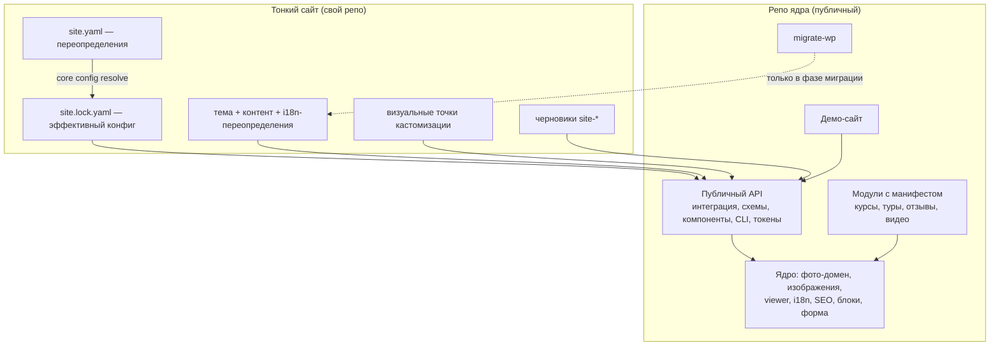
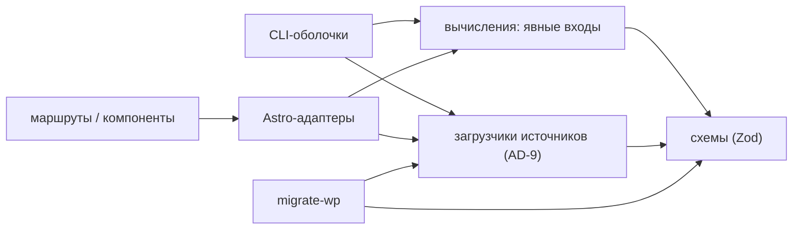
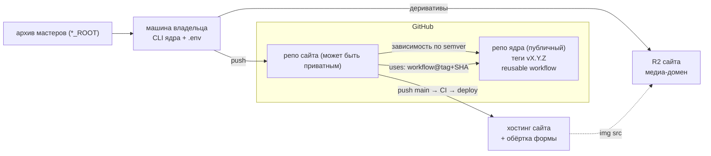

# Architecture Spine — общее ядро и тонкие сайты

## Design Paradigm

**Microkernel.** Ядро — фото-домен и инфраструктура сайта; вокруг — опциональные модули, которые
сайт включает конфигом. Поставляется как версионируемая **Astro-интеграция** (прецедент — Starlight):
типизированный конфиг, тема на CSS-переменных, небольшой набор визуальных точек кастомизации.
**Functional core / imperative shell** применяется по пользе: повторно используемые вычисления
получают явный вход, адаптеры загружают данные и связывают их с Astro/CLI. Принадлежность к `lib`
сама по себе не требует чистоты; разделение помогает переносу, проверке и сопровождению.



## Invariants & Rules

### AD-1 — Ядро — версионируемый пакет, сайт — тонкий репо [ADOPTED]

- **Binds:** all
- **Prevents:** три расходящихся форка; правки ядра внутри сайта; ручное слияние зависимостей ядра.
- **Rule:** ядро поставляется как Astro-интеграция с semver-версиями, которые каждый сайт закрепляет
  независимо. Обновление сайта — смена версии зависимости. Код ядра в репо сайта не копируется и не
  правится, в том числе через `pnpm patch`.

### AD-2 — Топология репозиториев [ADOPTED]

- **Binds:** core-repo, demo-site, все сайты
- **Prevents:** ядро без собственной проверки; ядро, живущее внутри одного из сайтов; демо, которое
  проверяет исходники, а не то, что получат сайты.
- **Rule:** один репо ядра содержит пакет(ы) ядра, migrate-wp, skills и демо-сайт. Демо в CI ядра
  ставит ядро из упакованного артефакта (`pnpm pack`), а не из исходников. Каждый реальный сайт —
  отдельный тонкий репо. Демо хранит статические производные вместе с сайтом и собирается обычным
  production-путём без R2, секретов и dev/E2E-флагов; manifest, `<picture>`, `srcset` и viewer общие
  с реальными сайтами. Текущий репо исходного сайта — источник извлечения; его преемник — новый тонкий
  репо сайта №1. Закрывает открытый вопрос ADR-0003.

### AD-3 — Сайт видит только публичный API; лестница кастомизации [ADOPTED]

- **Binds:** все сайты, core-repo
- **Prevents:** обновление ядра как лотерея из-за глубоких импортов.
- **Rule:** сайт импортирует только то, что объявлено в `exports` пакета ядра; импорт внутренних путей
  запрещён lint-правилом в пресете ядра. Уровни кастомизации:
  1. конфиг (`site.yaml`, AD-19);
  2. тема (токены, шрифты, логотип, водяной знак — AD-24);
  3. контент, словари i18n (AD-23), юридические тексты;
  4. ограниченные именованные точки замены визуальных частей (AD-24);
  5. черновики своих страниц и фич (AD-4).

### AD-4 — Черновик сайта → модуль ядра [ADOPTED]

- **Binds:** все сайты, core-repo
- **Prevents:** постоянные локальные форки; черновики на внутренностях ядра; поломка данных черновика
  при переносе в ядро.
- **Rule:** черновик живёт в сайте в зарезервированном пространстве имён `site-*` (коллекции,
  сегменты маршрутов, i18n-ключи, секция `site:` в конфиге) и объявлен манифестом (AD-18). Опирается
  только на публичный API; потребность во внутренности ядра — запрос на расширение API. Решение о
  переносе принимает сопровождающий ядра (владелец); естественный триггер — фича нужна второму сайту.
  Релиз с перенесённым модулем описывает перевод данных черновика в `UPGRADING.md` (AD-7); отдельный
  скрипт поставляется по необходимости. После перехода сайт удаляет черновик.

### AD-5 — Фото-домен — база ядра; различия сайтов — опциональные модули [ADOPTED]

- **Binds:** core-repo, все сайты
- **Prevents:** фичи одного сайта как его собственный код; перечни домена, зашитые под один сайт.
- **Rule:** альбомы, фото, таксономия, viewer и пайплайн изображений — ядро. Курсы, туры, отзывы,
  видеокаталог — модули (AD-18), их включает конфиг сайта. Перечни домена (категории альбомов вроде
  `series|places` или `ladies|men|pairs|ice-dance`, виды мест и тегов, включая негеографические
  измерения — события, персоны) — конфиг со значениями по умолчанию в ядре. Сторонние встраивания
  (YouTube, видеохостинги, веб-камеры) — один блок ядра с белым списком хостов в конфиге сайта.

### AD-6 — Локали и происхождение сайта — конфиг сайта [ADOPTED]

- **Binds:** core-repo, все сайты
- **Prevents:** ядро только для `en/ru` с опорной `ru`; три владельца списка локалей и origin
  (`astro.config.mjs`, `site.yaml`, `routes.ts`).
- **Rule:** список локалей (одна и более), опорная локаль и origin сайта задаются только в конфиге
  сайта; `astro.config.mjs`, маршруты, sitemap, SEO и URL прав, вшиваемые в метаданные изображений,
  выводят их оттуда; интеграция ядра падает, если `astro.config` задаёт `site` или `i18n` в обход
  конфига. Ядро не содержит литералов
  локалей и дублированных деревьев страниц на локаль. Правила ADR-0013 действуют относительно опорной
  локали из конфига; при одной локали Tier-1 поля просто живут в ней, а `translatedFromDigest` не
  возникает.

### AD-7 — Публичный API и версии [ADOPTED]

- **Binds:** core-repo, все сайты
- **Prevents:** обновление без понятного перехода; лишний перевыпуск изображений; обязательная
  автоматизация каждого изменения формата.
- **Rule:** публичный API ядра — это:
  - `exports` пакета и документированные точки визуальной кастомизации (AD-24);
  - схемы файлов сайта, которые читает ядро (конфиг, коллекции, таксономия, featured,
    дескриптор и манифест изображений, леджеры, реестр мастеров);
  - имена MDX-компонентов и директив;
  - имена токенов и i18n-пространства (AD-23);
  - документированные команды CLI и переменные окружения потребителя.

  Внутренние переменные runners и тестовые протоколы не становятся API сайта. CI ядра сторожит
  объявленный API снапшотами; изменение снапшота требует оценки совместимости.

  Файлы сайта несут `schemaVersion` (для контентной коллекции — одна версия в lock). Неподдерживаемая
  версия отклоняется с диагностикой. Переход формы не требует перезапуска пайплайна изображений.
  Репо ядра и его CHANGELOG продолжают нумерацию исходного репо (`1.<epic>.<story>`, с 1.6.x), чтобы
  история версий оставалась сквозной; npm-версия пакета ядра отдельна. До принятия ядра первым
  реальным сайтом в 9.3 она остаётся `0.x` — `0.<epic>.<story>` выпускающей истории (первая
  публикация — `0.6.9`): ломающим может быть любой более высокий выпуск, его отличает раздел в
  `UPGRADING.md`, и сайт закрепляет ядро точной версией. С `1.0.0` в 9.3 — обычный semver:
  исправления — patch, совместимые возможности — minor, изменение, требующее адаптации конфига,
  контента или кода сайта, — major.

  Побайтовая стабильность обязательна для явно определённых хешей, адресов и повторного
  использования изображений: `configDigest` манифеста, ключа деривативов и `translatedFromDigest`;
  golden-тест закрепляет их байты на зафиксированных входах. Форматирование YAML или отчёта само по себе не делает выпуск ломающим.
  Изменение умолчания, нарушающее совместимость либо требующее перевыпуска деривативов, — ломающее.

  Каждый ломающий выпуск добавляет переход в версионированный `UPGRADING.md` (разделы по npm-версии
  ядра; PR-гейт сверяет с ним ломающие изменения снапшота и подъём версии): исходная и целевая
  версии, изменения с примерами «до/после», порядок, версии нужных писателей и проверка результата
  от исходной формы данных. Пропущенные выпуски
  проходят по цепочке инструкций. Универсальная команда `core upgrade` и постоянная поддержка N−1
  не обязательны. Трудоёмкие или чувствительные к ошибкам переходы получают отдельный скрипт;
  производные артефакты переписывает их команда-писатель (AD-10).

### AD-8 — Явные входы вычислений и границы адаптеров [ADOPTED]

- **Binds:** core-repo
- **Prevents:** неявная зависимость вычислений от сайта; поиск данных потребителя внутри пакета;
  утечка CLI или миграции в рантайм; рефакторинг ради чистоты всего каталога `lib`.
- **Rule:** повторно используемые вычисления получают данные и конфиг явно. IO/Astro/CLI-адаптеры
  могут загружать конфиг и источники через их загрузчики (AD-9). Ответственность определяет границу;
  само расположение в `lib` не требует чистоты. Разделение выполняется там, где помогает переносу,
  проверке или сопровождению, без обязательной переработки всех существующих построителей моделей.
  Области вычислений и адаптеров явно закреплены в lint-конфигурации и её тестах. Статический и
  динамический импорт проверяются одинаково; вычисления не импортируют IO/Astro-адаптеры.
  `src` не импортирует CLI, рантайм не импортирует
  migrate-wp, конфиг/схемы не зависят от вычислительной логики. `src/pages` содержит только маршруты.

  Ресурсы ядра адресуются относительно установленного пакета; контент, конфиг, тема и производные
  файлы потребителя — относительно корня сайта из Astro-интеграции. `process.cwd()` не заменяет
  эти два разных источника путей. Реальная цепочка выбора CSS и чтения альбома проверяется из
  установленного tarball в отдельном потребителе в 6.1; исправления входят в 6.2.



### AD-9 — Один загрузчик и одна схема на источник данных [ADOPTED]

- **Binds:** core-repo
- **Prevents:** три способа загрузить конфиг; разбор манифеста в восьми местах; расходящиеся копии
  схем.
- **Rule:** у каждого источника (эффективный конфиг, дескриптор и манифест изображений, таксономия,
  реестр мастеров, леджеры) ровно один модуль чтения и одна схема, работающие и под Astro/Vite, и в
  Node (без `?raw`). Все потребители, включая CLI и гейты, идут через него.

### AD-10 — Один писатель на производный артефакт [ADOPTED]

- **Binds:** core-repo, skills
- **Prevents:** одно поле, которое пишут скрипт и агент руками.
- **Rule:** каждый производный файл или поле пишет одна команда ядра (режимы — флаги этой команды):
  - `site.lock.yaml` — `core config resolve`;
  - дескриптор релиза изображений — `core images activate` (bootstrap — её режим);
  - `src/generated/*` — парная команда-генератор;
  - `translatedFromDigest` — `core translation-marker` (compute/stamp/confirm);
  - factcheck-ledger — `core factcheck`.

  Агенты вызывают команду и не правят результат руками; это заменяет соответствующие разделы ADR-0011
  и ADR-0012 о нескольких писателях. Исключение — текстовый слой `src/content`: правится руками
  (ADR-0012) и защищён `content:validate`.

### AD-11 — Миграция — фаза, а не часть жизни сайта [ADOPTED]

- **Binds:** migration-kit, core-repo, все сайты
- **Prevents:** миграционный код и тесты в рантайме и в `check` живого сайта; живые данные, увезённые
  в миграцию.
- **Rule:** migrate-wp — отдельный пакет со своими тестами, вне `check`/`test` живого сайта и вне
  рантайм-графа. Он и skill `import-wp` ставятся в сайт только на фазу миграции; флаг
  `migration.closed: true` в конфиге удаляет их и снимает их проверку версии (AD-20), после чего
  migrate-wp в `src/content` не пишет. Пишет он только в явной фазе миграции (`import-wp`). Данные
  классифицируются по читателю, а не по папке: то, что читает живой сайт или пайплайн (реестр
  мастеров, factcheck-ledger), — живые данные ядра (AD-9); то, что читает только импортёр (decisions,
  errata, маппинги, legacy-корпус), — данные миграции сайта в его репо. ADR-0011 действует только
  внутри migrate-wp. Хелперы, нужные рантайму (managed-note-регион, свежесть перевода для `/status/`),
  и factcheck отвязаны от модулей импортёра и legacy-корпуса. migrate-wp не знает ни одного
  конкретного сайта: особенности источника — адаптеры (qtranslate, одноязычный WP, WP Media Folder,
  zu-media, форматы записей), соответствия — конфиг миграции сайта.

### AD-12 — Операции — это CLI ядра [ADOPTED]

- **Binds:** core-repo, все сайты
- **Prevents:** ~90 скриптов, скопированных в каждый сайт; CLI, который не запускается из
  `node_modules`.
- **Rule:** пайплайн изображений, валидация контента, гейты, миграция, `config resolve` и
  установка skills — команды CLI ядра; скрипты отдельных обновлений добавляются по необходимости
  (AD-7). `bin` поставляется собранным JS в релизном артефакте (Node не исполняет `.ts` внутри
  `node_modules`, установка не требует build-скриптов). В `package.json` сайта — только тонкие алиасы.

### AD-13 — Агентский и тулчейн-набор версионируется с ядром [ADOPTED]

- **Binds:** core-repo, все сайты
- **Prevents:** skill, вызывающий команду, которой нет в установленной версии; расходящиеся правила
  кода и агентов на сайтах.
- **Rule:** content-ops skills (`add-album`, `process-images`, `translate`, `validate`, `fixcontent`,
  `sync-mdx`, `factcheck`, `factcheck-apply`, `front-audit`; `import-wp` — из migrate-wp и только на
  фазу миграции, AD-11), пресеты
  ESLint/Prettier/TS/markdownlint и управляемый блок правил `AGENTS.md` лежат в репо ядра и
  устанавливаются в сайт командой ядра. Skills вызывают команды CLI ядра, а не алиасы сайта. Свои
  skills сайта допустимы рядом, но не могут занимать имя ядрового skill.

### AD-14 — CI — переиспользуемый workflow; один авторитетный гейт на контракт [ADOPTED]

- **Binds:** core-repo, все сайты
- **Prevents:** гейты только в локальном pre-push; один контракт, проверяемый разными способами;
  утечка секретов в переиспользуемый workflow.
- **Rule:** CI сайта — переиспользуемый workflow из репо ядра, подключённый по тегу и SHA; он
  запускает CLI из lockfile сайта и прогоняет полный набор гейтов. Секреты и `PUBLIC_*`-переменные
  передаются явно, без `secrets: inherit`. CI держит токен деплоя и read-only доступ к R2; запись в R2 —
  только с локальной машины (ADR-0004); деплой — только на push в `main`. Публикации сериализуются;
  внутри секции публикации до Wrangler проверяется актуальный `main`, устаревший запуск не публикует.
  Каждый
  контракт имеет ровно один авторитетный гейт в реестре «контракт → гейт → писатель», который ведёт
  ядро (собственная валидация `astro build` — побочная, не второй гейт). Drift-гейт только проверяет.

### AD-15 — Инфраструктура и окружение — у каждого сайта свои [ADOPTED]

- **Binds:** все сайты, core-repo
- **Prevents:** домены, бакеты, аккаунты, секреты и пути одного сайта внутри ядра; ядро, привязанное к
  одному хостингу.
- **Rule:** у сайта свой проект хостинга, свой бакет R2 и медиа-домен, свои секреты формы. Ядро знает
  только имена переменных и ключи конфига. Локальные корни (`LEGACY_WP_ROOT`, `LEGACY_EXPORTS_ROOT`,
  `IMAGES_MASTERS_ROOT`, `IMAGES_ARCHIVE_ROOT`) задаются в gitignored `.env` сайта; локальное
  legacy-дерево — единственный источник истины о старом сайте, удалённые копии им не являются;
  `check:local-paths` — гейт ядра. Обработчик формы в ядре — платформенно-независимый `fetch`-хендлер;
  тонкая платформенная обёртка (для Pages — `functions/`) лежит в сайте. Схема раздельного деплоя ADR-0004 действует для каждого
  сайта.

### AD-16 — Перенос ADR в ядро [ADOPTED]

- **Binds:** core-repo, все сайты
- **Prevents:** значения одного сайта, зашитые в ядро как правила; ADR, о статусе которых никто не
  знает.
- **Rule:**

  | ADR | Статус в новой архитектуре |
  | --- | --- |
  | 0001 Astro, 0005 пины тулчейна, 0006 native-first JS | правила ядра |
  | 0002 хостинг и форма, 0004 раздельный деплой | паттерн для каждого сайта; хостинг — AD-15 |
  | 0003 общее ядро | закрыт AD-1/AD-2 |
  | 0007 таксономия | модель — ядро; конкретные категории — умолчания ядра |
  | 0008 ширины контейнеров | значения — умолчания ядра (дополнение «все блоки в `site.yaml`» заменено AD-19) |
  | 0009, 0010, 0012, 0013 | правила ядра (0012/0013 с уточнениями AD-10 и AD-6) |
  | 0011 errata | только migrate-wp (AD-11) |
  | 0014 лестница ширин | механизм — ядро; ширины — умолчания ядра |

### AD-17 — Порядок: шов на месте, затем вынос [ADOPTED]

- **Binds:** работы по извлечению ядра
- **Prevents:** «большой скачок» без страховки существующих гейтов.
- **Rule:** сначала в исходном репо под действующими гейтами:
  - вынос идентичности сайта из кода в конфиг, тему и контент (origin, меню, соцсети, юридический
    текст, цвета, шрифты, классы `zu-*`, `robots.txt`);
  - AD-6, AD-8 … AD-11, AD-25;
  - удаление мёртвого кода.

  Конкретный перечень работ с доказательствами и фазами — `STREAMLINE-CATALOG.md` (рядом со spine);
  каждая его строка ссылается на AD, которое она выполняет.

  Затем подготовленное ядро переносится в новый репо — только то, что прошло отбор. Порядок сайтов:
  сайт №1, затем №2, затем №3, когда на ядре работают минимум два сайта.

### AD-18 — Манифест модуля и гейт коллизий

- **Binds:** core-repo, модули, черновики сайтов
- **Prevents:** включение модуля в шести местах вручную с рассинхроном; молчаливые коллизии имён
  маршрутов, коллекций, MDX-компонентов, i18n-ключей.
- **Rule:** каждый модуль ядра и каждый черновик сайта объявляет манифест: коллекции, сегменты
  маршрутов, секцию конфига (`modules.<id>`), i18n-пространство, MDX- и директивные имена, токены,
  пункты меню, зависимости от других модулей. Сайтовый `src/content.config.ts` — одна строка вызова
  построителя ядра, который собирает коллекции из ядра и включённых манифестов. Сборка падает на любой
  коллизии имён между ядром, модулями, черновиками и slug'ами контента. Курсы — эталонная реализация
  модуля.

### AD-19 — Конфиг: переопределения + lock-файл

- **Binds:** core-repo, все сайты
- **Prevents:** молчаливая смена поведения сайта новым значением по умолчанию ядра; нечитаемый полный
  конфиг.
- **Rule:** весь конфиг, который читает ядро (сайт, SEO, изображения, границы мест, модули, черновики),
  — одно дерево переопределений в `site.yaml`, которое пишет владелец. `site.lock.yaml` — эффективный
  конфиг (умолчания ядра + переопределения): генерирует `core config resolve`, файл коммитится и руками
  не правится. Сборка и рабочие команды читают эффективный конфиг из lock. `config resolve` читает
  умолчания и переопределения; шаги перехода могут читать старую форму по инструкции AD-7.
  Drift-гейт падает, если lock не совпадает с
  результатом resolve, — новое умолчание ядра всплывает как просматриваемый diff. Секции модулей и
  черновиков валидируются схемами из их манифестов. Схема lock строгая (`.strict()`, fail-closed).
  Хеш конфига изображений считается не от байтов lock, а от определённого ядром набора полей, влияющих
  на деривативы, с `digestVersion`; изменение формы конфига при тех же значениях этих полей сохраняет
  хеш. Смена значимых байтов/семантики оценивается по AD-7; переход описывается в `UPGRADING.md`.

### AD-20 — Одна версия ядра на сайт

- **Binds:** core-repo, все сайты
- **Prevents:** сайт, у которого пакет, workflow, skills и migrate-wp разных версий.
- **Rule:** версия ядра сайта — та, что в его lockfile. CI запускает CLI из него; установленные skills
  и migrate-wp (пока миграция не закрыта) несут штамп версии; гейт падает, если тег workflow, штамп
  skills или версия migrate-wp расходятся с установленным ядром. Связанное через `pnpm link` ядро
  допустимо только локально; в CI гейт его запрещает.

### AD-21 — Тесты не закрепляют конфиг реального сайта

- **Binds:** core-repo, все сайты
- **Prevents:** тесты, которые ломаются от допустимой правки конфига или на другом сайте.
- **Rule:** тесты ядра работают на фикстурах и демо-сайте и никогда не читают конфиг реального сайта.
  Тест, названный по ADR, проверяет значение по умолчанию ядра. Против реального конфига сайта
  проверяются только контракты, и только на `site.lock.yaml`: проходит схему, набор ключей совпадает
  с требуемым.

### AD-22 — Ядро без идентичности; публичность по гейту

- **Binds:** core-repo
- **Prevents:** утечка доменов, аккаунтов, путей и контента владельца в публичный репо.
- **Rule:** репо ядра публичный, но становится таким только после того, как проходит гейт
  идентичности: в ядре нет доменов, имён, аккаунтов и ID Cloudflare, бакетов, локальных путей и
  дисков, конфигов и контента исходного сайта. Фикстуры, эталоны и тестовые корпуса ядра и migrate-wp
  — синтетические. Гейт идентичности в репо ядра проверяет по шаблонам (домены, абсолютные пути,
  ID аккаунтов), а конкретный список запрещённых строк владельца хранится вне репо ядра и
  прогоняется локально перед публикацией. Гейт и `check:local-paths` входят в CI ядра постоянно.
  Сайты могут оставаться приватными.

### AD-23 — Владение i18n-ключами

- **Binds:** core-repo, модули, все сайты
- **Prevents:** ключ из нового релиза ядра, отрисованный как `undefined`; откат на захардкоженную
  локаль на моноязычном сайте.
- **Rule:** ядро и каждый модуль поставляют словари по умолчанию для своего пространства ключей.
  Словари сайта — частичные переопределения. Для каждой локали из конфига проверяется полнота набора
  ключей; отсутствующий ключ — ошибка сборки, а не откат на другую локаль.

### AD-24 — Ограниченная визуальная кастомизация и тема [ADOPTED]

- **Binds:** core-repo, все сайты
- **Prevents:** замена оформления, теряющая поведение меню/viewer; обещание проверить поведение
  списком DOM-хуков; зависимость смены темы от правки кода ядра.
- **Rule:** первый выпуск предоставляет тему, настройки и небольшой документированный набор
  именованных точек замены визуальных частей с типизированными пропсами/слотами. Интерактивное
  поведение и его DOM-структура остаются у оболочки ядра. Демо показывает одну такую замену;
  e2e проверяет взаимодействие, клавиатуру и ClientRouter-переходы. Полная произвольная замена
  интерактивного компонента добавляется по конкретной потребности сайта, а не обещается заранее.

  Тема использует экспортированные токены; неизвестное имя точки кастомизации или токена — ошибка.
  Проверка не требует от визуальной замены использовать каждый доступный токен. Общая шкала
  интервалов принадлежит CSS-теме; браузерная геометрия Gallery читает вычисленное расстояние.
  Layout-токены (`--container-*`) генерируются из конфига, тема их не задаёт. CSS ядра объявляет
  `@source` на пакет; демо проверяет генерацию класса, используемого только ядром.

### AD-25 — Архитектура CSS

- **Binds:** core-repo, модули, все сайты
- **Prevents:** монолитная таблица стилей, куда дописывается каждая фича; CSS всех вариантов на каждой
  странице; войны специфичности между ядром, сторонними библиотеками и темой сайта.
- **Rule:**
  - Каждый компонент владеет своим CSS-файлом рядом с собой (обычный `.css` со стабильными именами
    классов, не scoped `<style>`) и импортирует его сам.
  - Общий файл стилей содержит только подключение Tailwind, шрифты, токены, базу и прозу.
  - Весь CSS ядра, модулей и сторонних библиотек (включая `swiper`/`photoswipe`) лежит в слоях
    каскада, бесслойных правил нет. Тема и переопределения сайта выигрывают порядком слоёв, а не
    специфичностью.
  - CSS варианта (эффект меню, узор, раскладка) подключается только для варианта, выбранного в
    конфиге.
  - Цвета задаются только токенами; гейт падает на цветовом литерале вне файла токенов.
  - Комментарии в CSS короткие, на английском, без истории этапов.

## Consistency Conventions

| Concern | Convention |
| --- | --- |
| Код | `.cursor/rules/code-style.mdc`: табы, без `;`, одинарные кавычки, 100 колонок, `type` вместо `interface`, без `enum`/`any`, именованные экспорты, kebab-case файлы |
| Конфиг | YAML, ключи camelCase; модули — `modules.<id>`, черновики — `site.<id>`; каждый файл, читаемый ядром, несёт `schemaVersion` |
| Пространства имён | ядро — без префикса; модуль — `<id>`; черновик сайта — `site-<id>` (коллекции, маршруты, i18n, токены) |
| Идентификаторы контента | kebab-case slug; связь переводов — `translationKey`; Tier-1 поля — только в опорной локали |
| Даты | ISO 8601 |
| Ошибки валидации | стабильный машинный код + путь к файлу (`duplicate-id`, `locale-gap` …) |
| Переменные окружения | префикс по подсистеме (`R2_IMAGES_*`, `TURNSTILE_*`, `TELEGRAM_*`); `PUBLIC_*` — встраиваемые в сборку; локальные корни `*_ROOT` — только в `.env`; смешение режимов — fail-closed |
| Мутации | производное — только командой-писателем (AD-10); drift-гейт парен писателю |
| Тексты | документация ядра — по-английски; `docs/` сайта — по-русски; код, коммиты, CHANGELOG, PR — по-английски |

## Stack

Снимок на 2026-10-06; дальше версии принадлежат коду.

| Name | Version |
| --- | --- |
| Node | 24 (LTS) |
| pnpm | 11.14 |
| Astro | ^7.1 (peer ядра) |
| TypeScript | ^6.0 (пин ADR-0005: `@astrojs/check` не принимает TS 7) |
| React / React DOM | ^19.2 (peer ядра) |
| Tailwind CSS | ^4.3 |
| PhotoSwipe | ^5.4 |
| Swiper | 14.0.6 |
| sharp | 0.35.3 |
| ESLint | ^10.7 |
| Prettier | ^3.9 |
| Vitest | ^4.1 |
| Playwright | 1.61.1 |
| Wrangler | ^4.112 |
| Хостинг | Cloudflare Pages + R2 (на сайт) |

## Operational Envelope

| Измерение | Решение |
| --- | --- |
| Окружения | только production + локальная машина; без staging и preview |
| Цикл разработки ядро+сайт | ядро развивается в своём репо на демо-сайте; проверка на реальном сайте — через `pnpm link` ядра в сайт; в `main` сайта — только релизная версия ядра |
| Релиз ядра | владелец поднимает версию пакетов в `main`, релизный workflow публикует в npm то, чего там нет (ADR-0016); CHANGELOG ядра; перед подъёмом версии — зелёный CI ядра (демо из упакованного артефакта) и smoke-сборка сайта №1 на кандидате |
| Обновление сайта | цепочка переходов `UPGRADING.md` от установленной версии к целевой → `core config resolve` → просмотр diff → полный CI; отдельные скрипты запускаются только где указаны |
| Тестовое разделение | ядро: юнит, схемы, снапшоты API, e2e на демо; сайт: контракты конфига и контента, гейты, сборка, smoke его страниц |
| Секреты | у каждого сайта свои, в настройках хостинга и GitHub; в ядре только имена |
| Наблюдаемость | логи хостинга Cloudflare; отдельного мониторинга нет |
| Провижининг инфраструктуры | вручную в дашборде Cloudflare на сайт; R2 бесплатный лимит, вероятно, общий на аккаунт — бюджет на все сайты |
| Бюджет CI | публичное ядро; приватные сайты делят бесплатные минуты Actions — держать workflow сайта лёгким |

## Structural Seed



```text
core-repo/
  packages/core/          # интеграция: компоненты, layouts, lib, схемы, модули, CLI (собранный JS)
  packages/migrate-wp/    # migration kit (AD-11)
  skills/                 # content-ops skills (AD-13)
  presets/                # ESLint/Prettier/TS/markdownlint + блок AGENTS.md
  demo/                   # демо-сайт — фикстура, ставит ядро из pack
  .github/workflows/      # reusable site workflow (AD-14)

site-repo/
  astro.config.mjs        # интеграция ядра + визуальные точки кастомизации
  site.yaml               # переопределения (пишет владелец)
  site.lock.yaml          # эффективный конфиг (пишет core config resolve)
  src/content.config.ts   # одна строка: построитель коллекций ядра
  src/content/            # контент (единственный источник, ADR-0012)
  src/theme/              # токены, шрифты, логотип, водяной знак
  src/i18n/               # частичные переопределения словарей
  src/generated/          # производные файлы (дескриптор изображений и т.п.)
  src/drafts/             # черновики site-* (AD-4)
  functions/              # тонкая обёртка обработчика формы
  public/                 # _redirects, robots.txt
  data/                   # живые данные сайта (реестр мастеров, леджеры)
  migration/              # данные миграции сайта (AD-11)
  .env                    # локальные *_ROOT, gitignored
```

## Deferred

| Что | Почему может подождать | Когда решать |
| --- | --- | --- |
| Имя пакета и scope npm (канал — публичный npm с trusted publishing, общая версия core и migrate-wp — решены в [ADR-0016](../../../../docs/adr/0016-core-delivery-channel.md)) | канал и версии решены, имя влияет только на первую публикацию | в 6.2, до первой публикации |
| Разбиение `packages/core` (один пакет или core + cli + modules) | определится реальным размером | при выносе |
| Внутреннее устройство модулей туров, отзывов, видео | контракт фиксирует AD-18 | при портировании сайта №2 |
| Видео сайта №2: где взять исходники ~30 роликов (встроены с vzaar, купленного Dacast в 2019) и где хостить (YouTube/Vimeo, R2, Cloudflare Stream) | ядро видит видео только через блок встраивания или модуль (AD-5) | до начала портирования сайта №2 — найти исходники |
| Бюджет R2 при больших галереях (сайт №3 — до ~438 фото на странице) и видео | лимит общий на аккаунт | при портировании сайтов №2 и №3 |
| Pages или Workers для новых сайтов | ядро платформенно-независимо (AD-15) | ADR при портировании сайта №2 |
| CMS / визуальное управление для владельца сайта | следующий этап | перед портированием сайта №3 |
| Политика обновлений и «заморозки» сайтов | каждый сайт закрепляет свою версию | через год или позже |
| Хранение бинарных эталонов (скриншоты ~10 МБ, `docs/reference/slider`), сведение конфигов Playwright | не влияет на совместимость сайтов | в ходе стримлайна (AD-17) |
| Содержимое демо-сайта | достаточно покрыть публичный API | при выносе |
| Судьба `docs/` текущего репо | правила ядра — в ядро, история сайта — в сайт | при выносе |
