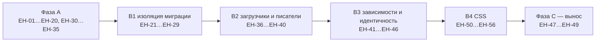

# Каталог стримлайна

**Выполнение 2026-10-24:** фазы A–B4 закрыты эпиками 1–5, включая 5.13.
Доказательства и оставшаяся работа — в closeout эпика 5 (репо сайта).
Фаза C остаётся впереди. Колонка `?` отражает согласование решений, а не выполнение задач;
исторические находки и номера EH сохранены.

Spine задаёт **правила** (куда идём). Этот каталог — **работа** (что конкретно поменять в
исходном репо, чтобы правила стали правдой). Каждая строка: что найдено → действие → какое AD она
выполняет → фаза.

**Фазы:**

- **A — гигиена.** Без архитектурных решений, безопасно сразу, полезно даже если вынос ядра
  отложится.
- **B — шов на месте.** Меняет структуру кода под действующими гейтами (AD-17).
- **C — при выносе.** Делается при переносе в репо ядра.

**Действия:** удалить · слить · перенести · починить · вынести в конфиг · спросить (решает владелец).

Колонка **?** — нужна ваша отметка: ✅ согласен, ❌ нет, ✏️ иначе.

## 1. Мёртвый код и мусор (фаза A)

| ID | Что | Доказательство | Действие | AD | ? |
| --- | --- | --- | --- | --- | --- |
| EH-01 | `src/lib/content/selectors.ts` (+test) | импортирует только свой тест | удалить | — | |
| EH-02 | `src/lib/blocks/callout/migrate.ts` (+test) — мигратор Gutenberg `zu/quote` | импортирует только свой тест; на него ссылается по номеру строки `front-audit/references/astro-pitfalls.md:522` | удалить, поправить ссылку в front-audit | — | |
| EH-03 | `src/lib/hero-cutover.test.ts` | сторожит давно завершённый cutover статического hero | удалить | — | |
| EH-04 | `scripts/apply-factcheck-plan.ts` | skill `factcheck-apply` его не вызывает | удалить + алиас | AD-10 | |
| EH-05 | `scripts/refresh-factcheck-digest.ts` (+test) | skill прямо говорит «no digest refresh» | удалить + алиас | AD-10 | |
| EH-06 | `scripts/refresh-translation-digest.ts` (+test) | заголовок врёт про `/fixcontent`; ни один skill не вызывает | удалить + алиас, поправить комментарий в `translation-marker.ts:11` | AD-10 | |
| EH-07 | `scripts/images/manifest-init.ts` | никогда не может отработать: отказывает при `active: true`, а релиз активен | удалить + алиас `images:manifest:init` | AD-10 | |
| EH-08 | `scripts/images/contact-sheet.ts` + алиас (библиотека `scripts/lib/images/contact-sheet.ts` и её тест — тоже, если больше никем не используются) | сирота: ни skill, ни CI | удалить | — | ✅ |
| EH-09 | `scripts/lib/images/generate-{metadata,source}-fixtures.ts` | одноразовые генераторы, никто не вызывает | удалить, убрать упоминание в `source-fixtures.ts:7` | — | ✅ |
| EH-10 | алиас `content:import:check` | точный дубль `content:import:full:check` | удалить, поправить `import-wp` SKILL:71 и `docs/08` | — | |
| EH-11 | алиас `test:e2e:update` | обновление снапшотов на хосте даёт плохие PNG (`front-audit/…/operational-lessons.md:34`), санкционирован docker-вариант | удалить | — | |
| EH-12 | алиас `dev:clean` | нигде не упоминается | оставить: владелец пользуется часто | — | ✅ |
| EH-13 | `data/svg/*` (584 КБ: исходники логотипа `.idraw`/`.svg`) | ни одной ссылки | перенести в архив вне репо (место укажет владелец), удалить из git | AD-22 | ✅ |
| EH-14 | `docs/reference/slider` (3 МБ, мастера удалённого hero) | читается только старыми аудитами; изображения есть в архивах, папка была для тестов | удалить, поправить ссылку в `docs/design/home-legacy-audit.md:397` | — | ✅ |
| EH-15 | пустая `docs/migration/translation-drafts/` + её исключения в `.gitignore`/`.prettierignore`/`lint:md` | выход мёртвого после миграции `build-translation-draft.ts` | удалить вместе с EH-24 | AD-11 | |

## 2. Ложь в документации и комментариях (фаза A)

| ID | Что | Действие | AD | ? |
| --- | --- | --- | --- | --- |
| EH-16 | заголовки `check-translations.ts:11`, `check-errata.ts:8`, `check-content-decisions.ts:12` утверждают «входит в `pnpm check`» (последний — «и CI») | починить | AD-11 | |
| EH-17 | `docs/08-content-model.md:222-231,271` называет `content:import:check` и `content:errata:check` always-on гейтами | починить под ADR-0012 | AD-11 | |
| EH-18 | `check-images-policy.ts:13` «станет обязательным PR-гейтом» — до сих пор не в CI | починить вместе с EH-30 | AD-14 | |
| EH-19 | `public-domain-check.ts:6` — старый домен `img.example.com`; `ledger.ts:17` — домен в комментарии | починить | AD-22 | |
| EH-20 | `site.ts:491-493` утверждает «config не зависит от lib», а `site.ts:4-7` импортирует 4 модуля lib | починить вместе с EH-41 | AD-8 | |
| EH-57 | skills `add-album`, `process-images`, `sync-mdx`, `front-audit`, `shared/safety.md` запрещают `pnpm build` как «побочный эффект», хотя сборка занимает ~3 с и ничего не портит (замер 2026-10-08) | убрать запрет; сборка — обычная проверка перед «готово» (как в AGENTS.md) | — | ✅ |
| EH-61 | `/ver` — локальная команда в двух копиях (`.claude/commands/ver.md`, `.cursor/commands/ver.md`), смешивает общее и частное; источник версии — roadmap (устарел), внутри запрет `pnpm build` (отменён) | перенести в глобальный skill `~/.claude/skills/ver` (по образцу `cm`), удалить обе копии; в AGENTS.md оставить одну строку-уточнение (язык CHANGELOG, источник версии). Глобальная папка — только с отдельного «да» владельца | — | ✅ |

## 3. Миграция внутри живого сайта (фаза B)

| ID | Что | Доказательство | Действие | AD | ? |
| --- | --- | --- | --- | --- | --- |
| EH-21 | **25 миграционных тест-файлов (~4450 строк) в `pnpm test` → `pnpm check`**; 5 из них запускают миграционные CLI (`import-content.ts` ×4, `build-content-fixture.ts` ×1) | `vitest.config.ts` включает `src/**` и `scripts/**` целиком | вывести в отдельный vitest-проект `migration`, вне `check` | AD-11 | |
| EH-22 | ~5,1 тыс. строк миграционного кода в `src/lib` (`wordpress/*`, `qtranslate`, `importer`, `import-modes`, `full-mapping`, `decisions*`, `publication-input`, `taxonomy-aliases`, `image-coverage`, `legacy-corpus`, `translations`, `translation-review`, `errata`) | из рантайма не достижим ни один | перенести в изолированную зону `migration/` (будущий migrate-wp) | AD-11 | |
| EH-23 | миграционные скрипты: `import-content`, `normalize-wordpress`, `match-masters`, `map-found-masters`, `build-content-fixture`, `check-fixture-projection`, `build/check-content-decisions`, `build/check-translations`, `build-translation-draft`, `check-errata`, `recover-content-links` | только `import-wp` skill, миграционные доки и свои тесты | перенести в `migration/` вместе с EH-22 | AD-11 | |
| EH-24 | миграционные данные: `data/migration/*` (кроме EH-26), `data/legacy/fixtures/representative.json`, `data/content/{album,photo}-editorial.yaml` | читают только импортёр и миграционные тесты | перенести в `migration/data/` | AD-11 | |
| EH-25 | **`/factcheck` (живой skill) зависит от миграции**: `content-factcheck-io.ts` читает `decisions.ts` → `s12-content-decisions.yaml` и `legacy-corpus.ts` → `data/legacy/normalized/*.jsonl`; `factcheck.ts` type-импортирует `wordpress/normalize`, `importer`, `decisions` | граф импортов | перевести factcheck на чтение `src/content` (рабочий источник по ADR-0012), типы перенести | AD-11 | |
| EH-26 | `data/migration/s12-content-decisions.yaml` и `data/legacy/normalized/*` живы только из-за EH-25 | — | после EH-25 перенести в `migration/data/` | AD-11 | |
| EH-27 | живые данные лежат в «миграционных» папках: `data/legacy/master-matches.jsonl` (реестр мастеров), `data/content/factcheck-ledger.yaml` | `source-resolver.ts`, skills `add-album`/`process-images`/`factcheck` | перенести в `data/` по читателю (`data/images/masters.jsonl`, `data/factcheck/ledger.yaml`) | AD-9, AD-11 | |
| EH-28 | `src/lib/content/import-modes.ts:6` импортирует `scripts/lib/site-content.ts` — единственный импорт `src → scripts` | — | уйдёт вместе с EH-22 | AD-8 | |
| EH-29 | `photo-colormode.json` + гейт `check:colormode` в `pnpm check`: рантайм читает `colorMode` из YAML фото, а sidecar нужен только импортёру | граф импортов | `images:colormode` пишет `colorMode` прямо в YAML фото; `photo-colormode.json`, `photo-colormode.ts` и гейт `check:colormode` удаляются; skill `process-images` (фаза 3) обновляется | AD-10, AD-11 | ✅ (а) |

## 4. Гейты и CI (фаза A)

| ID | Что | Действие | AD | ? |
| --- | --- | --- | --- | --- |
| EH-30 | 6 гейтов из `pnpm check` не запускаются в CI: `check:pages`, `check:local-paths`, `check:images-policy`, `check:images-public-config`, `check:colormode`, `check:layout-tokens` — ловит только локальный pre-push | добавить в job `gates` | AD-14 | |
| EH-31 | `layout-tokens.test.ts:48-52` дублирует `check:layout-tokens` и читает синглтон `site` | удалить тест-дубль после EH-30 | AD-14, AD-21 | |
| EH-32 | `fixture-drift.test.ts` — точный дубль `content:fixture:check` (запускает его же) | уходит с EH-21 | AD-11, AD-14 | |
| EH-33 | `repository-content.test.ts` дублирует `content:validate` **и** закрепляет `REFERENCE = 'ru'` и счётчики корпуса (5/17/10/28) + список id курсов — нарушение правила AGENTS.md «не закреплять конфиг в тестах» | удалить дубль; если нужен контрактный тест — только «проходит схему» | AD-14, AD-21 | |
| EH-34 | `astro build` выполняется 6 раз на PR и 8 на push в `main`; 4 из 6 конфигов Playwright собирают сайт сами | одна сборка в CI как артефакт, e2e-джобы получают `dist/`; конфиги Playwright свести к общей базе | AD-14 | |
| EH-35 | ESLint не имеет ни одного правила границ импортов (нет `no-restricted-imports`, `boundaries`, `no-cycle`) | добавить правила: `src ↛ scripts`, рантайм ↛ `migration/`, вычислительные модули ↛ синглтон конфига; IO/Astro-адаптеры определены явно; static/dynamic проверяются одинаково | AD-8 | |
| EH-58 | подавления ошибок ничем не ограничены, кроме правила в AGENTS.md | включить `@typescript-eslint/ban-ts-comment` (запрет `@ts-ignore`, пояснение к `@ts-expect-error`) и `reportUnusedDisableDirectives` | — | ✅ |
| EH-59 | AI-атрибуция в коммитах запрещена только текстом; нарушалась дважды (`76f2ac8`, `c610695`) | husky-хук `commit-msg`, отклоняющий `Co-authored-by: Claude…`, «Generated with…» и scope не из списка AGENTS.md (список читается из AGENTS.md или общего файла, не дублируется в хуке); после этого строка про атрибуцию в AGENTS.md удаляется | — | ✅ |
| EH-62 | стилевые правила `code-style.mdc` не проверяются: `interface` в 91 файле, ~1450 комментариев с заглавной, default-экспорт в `hero-slider.tsx` | ESLint: `consistent-type-definitions: type` и `capitalized-comments: never` (с автоисправлением одним прогоном), `no-restricted-syntax` для `enum`, `no-restricted-exports` для default (исключения — конфиги инструментов, `astro.config.mjs`); затем убрать эти пункты из AGENTS.md. JSDoc: до выноса запрещён в коде приложения; в ядре — только на публичном API (`eslint-plugin-jsdoc`: требовать на экспортах из `exports`, запрещать в остальном коде) | AD-3 | ✅ |

## 5. Дубли загрузчиков, схем и писателей (фаза B)

| ID | Что | Действие | AD | ? |
| --- | --- | --- | --- | --- |
| EH-36 | `site.yaml` грузится 3 способами (`site.ts` через `?raw`, `scripts/lib/site-content.ts`, `scripts/lib/site-layout.ts`), путь продублирован; `seo.yaml` — 2 способа | один загрузчик, работающий и в Vite, и в Node | AD-9 | |
| EH-37 | `images-release.json` читается напрямую в 7 местах вместо `loadReleaseDescriptor` (из них 2 с захардкоженным путём) | все через один загрузчик | AD-9 | |
| EH-38 | `z.enum(['en','ru'])` для опорной локали объявлен 3 раза; regex sha256 — в 8 местах | одна схема, импортировать | AD-9 | |
| EH-39 | `translatedFromDigest` пишут 3 пути: скрипт, `/translate` — руками (`translate/SKILL.md:67,71-72,149`), `/validate` — через хелпер | `/translate` вызывает режим записи команды, не правит руками | AD-10 | |
| EH-40 | factcheck-ledger пишут 2 скрипта и `/factcheck` руками (`factcheck/SKILL.md:111-121`) | слияние делает команда `factcheck`, skill её вызывает | AD-10 | |

## 6. Направление зависимостей и идентичность сайта (фаза B)

| ID | Что | Действие | AD | ? |
| --- | --- | --- | --- | --- |
| EH-41 | 5 модулей `lib` импортируют синглтон `site` (`cards/build-data`, `content/build-data`, `more-docs/resolve`, `portfolio/photo-page`, `banner/build-data`); `config/site.ts` импортирует 4 модуля `lib` | конфиг передаётся на вход; перечисления-варианты перенести в слой схем | AD-8 | |
| EH-42 | локали зашиты: ~10 списков локалей, ~7 литералов опорной локали (`errata.ts:56`, `translations.ts:70`, `html-shell.astro:124` og:locale, `privacy-controller.astro`, `seo-artifact.ts:156` …), `astro.config.mjs:32-33` | всё выводится из конфига | AD-6 | |
| EH-43 | `src/pages/en/**` и `src/pages/ru/**` — по 10 файлов, 9 идентичны с точностью до `lang`, `contacts.astro` отличается ссылкой на privacy | один набор маршрутов с параметром локали | AD-6 | |
| EH-44 | `SITE_ORIGIN` литералом в `routes.ts:5` (питает `astro.config`, 3 лейаута, `smoke-production.ts`); `robots.txt:4`; список доменов в `factcheck.ts:43-50` | в конфиг; `robots.txt` генерировать | AD-6, AD-22 | |
| EH-45 | имя владельца и юр. текст в `rights.astro:45`; `navItems` и иконки в `i18n/ui.ts`; виды соцсетей зашиты в `social-icons.astro` (у других сайтов есть facebook, flickr, rss) | меню и соцсети — в конфиг; юр. текст — в контент | AD-3, AD-22 | |
| EH-46 | `global.css` 4274 строки: 1 блок `@theme`, ~49 hex-литералов в правилах компонентов (hero, меню, соцсети, pswp, форма), 41 селектор `.zu-hero-swiper` | токены — в отдельный файл темы; остальное — раздел 6a (EH-50…EH-56) | AD-24 | |

## 6a. CSS (фаза B)

`src/styles/global.css` — 4274 строки: ~3150 кода, ~585 комментариев, ~540 пустых. Подключается на
каждую страницу. Самые большие секции:

- портфолио — 931;
- страница фото — 479, внутри неё подвал и «Recent Works»;
- hero со Swiper — ~540;
- контактная форма — ~350;
- верхняя секция и кривая подвала — 289;
- 9 эффектов меню — 266;
- viewer — 259;
- полноэкранное меню — 210.

| ID | Что | Действие | AD | ? |
| --- | --- | --- | --- | --- |
| EH-50 | монолит `global.css`: стили 20+ компонентов в одном файле на всех страницах; секции не на своих местах (подвал и Recent Works внутри «страницы фото») | разрезать: CSS-файл рядом с каждым компонентом, импортирует компонент; в общем файле — только Tailwind, шрифты, токены, база, проза | AD-25 | ✅ |
| EH-51 | нет слоёв каскада: ядро, Swiper, PhotoSwipe и тема воюют специфичностью (пример — подъём до `.zu-hero-swiper.swiper` после View Transition) | весь CSS в `@layer`, включая `swiper/css` и `photoswipe/css`; убрать искусственные повышения специфичности | AD-25 | ✅ |
| EH-52 | CSS всех вариантов на каждой странице: 9 эффектов меню, 6 узоров верхней секции, раскладки альбомов, рамки карточек — при одном выбранном в конфиге | вынести каждый вариант в свой файл и подключать только выбранный | AD-25 | ✅ |
| EH-53 | ~49 hex-литералов в правилах компонентов (hero, меню, соцсети, pswp, форма); светлая тема переопределяет токены отдельным блоком | заменить токенами; гейт на цветовые литералы вне файла токенов | AD-24, AD-25 | ✅ |
| EH-54 | ~585 строк комментариев по-русски, многострочных, с историей этапов («S10 B4», «аудит п. 5», «порт zu …») — нарушение AGENTS.md | сократить до коротких английских, только «почему», без истории | AD-25 | ✅ |
| EH-55 | 41 селектор `.zu-hero-swiper` и легаси-имена `zu-*` в комментариях | переименовать в имена ядра (часть контракта DOM-хуков) | AD-24, AD-25 | ✅ |
| EH-56 | мёртвый CSS не измерен: из 290 классов 75 не встречаются буквально, но почти все собираются динамически или принадлежат Swiper/PhotoSwipe | замер покрытия CSS на собранном сайте по всем вариантам конфига; удалить то, что не используется ни в одном варианте | AD-25 | ✅ |

## 7. При выносе ядра (фаза C)

| ID | Что | Действие | AD | ? |
| --- | --- | --- | --- | --- |
| EH-47 | `e2e/__screenshots__` (10 МБ, 9 PNG, живые для `visual.spec.ts`) | визуальные эталоны остаются у сайта; у ядра — свои на демо-сайте; хранение (Git LFS или нет) — при выносе | AD-21 | |
| EH-48 | `docs/` (51 план, roadmap, ADR, миграционные отчёты ~0,5 МБ) | правила ядра (ADR-карта AD-16) — в репо ядра; история миграции — в репо сайта | AD-16 | |
| EH-49 | `stamp`-режим `stamp-translated-from-digest.ts` и его алиас — одноразовый бэкфилл S13 | убрать при сведении в `core translation-marker` | AD-10 | |
| EH-60 | ~4600 строк комментариев по-русски в `src/` и `scripts/` при правиле «комментарии по-английски» | переводить при выносе в ядро; до того — новые и изменённые комментарии пишутся по-английски | AD-22 | ✅ |

## Порядок внутри фаз

EH-25 (factcheck) — предусловие для EH-26; EH-30 — предусловие для EH-31; EH-21 закрывает EH-32. EH-56
(замер) делается до и после EH-50…EH-52, чтобы сравнить объём CSS на страницу. EH-55 зависит от EH-46.

## Уточнения после 5.12 (2026-10-23)

Владелец выбрал практическое разделение вычислений и адаптеров (AD-8); чистота всего `lib` не
является отдельной целью. Пять исправлений выполняются одним пакетом
5.13, контракт — SPEC-pre-core-fixes (оба в репо сайта). Они не меняют исторические EH-ID.
Спайк 6.1 проверяет реальные пути пакета и сайта; 6.2 устраняет найденные зависимости, делает
production-демо со статическими изображениями и объединяет чтение `places.yaml`.
